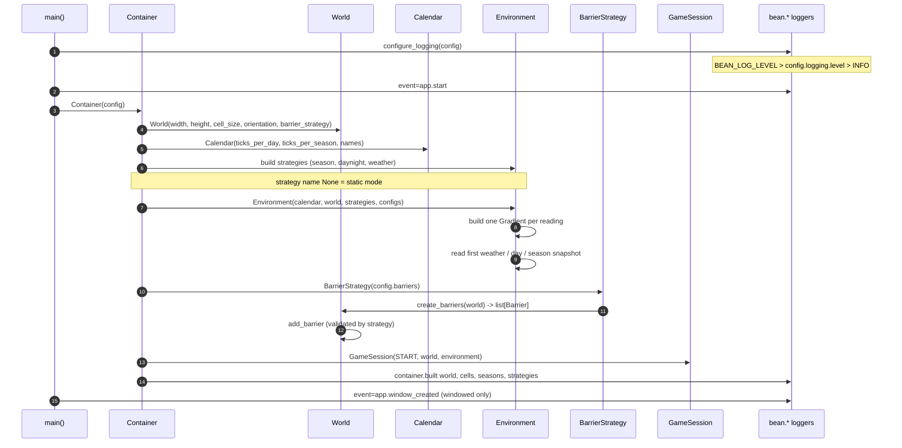
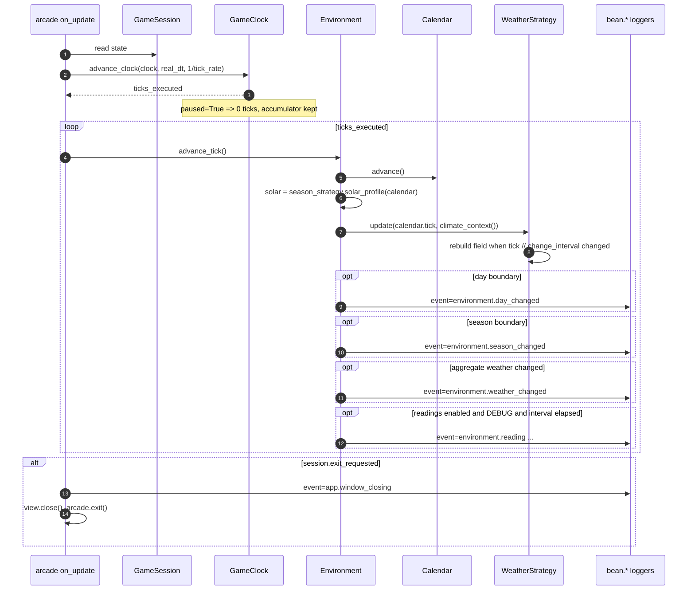
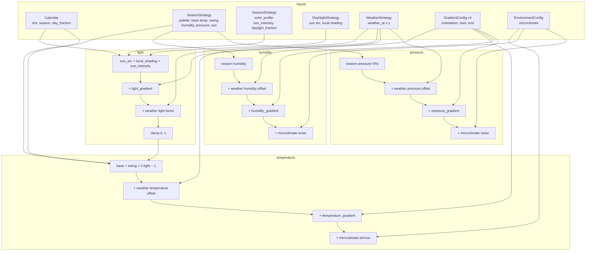
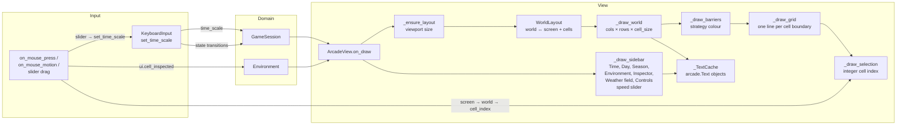
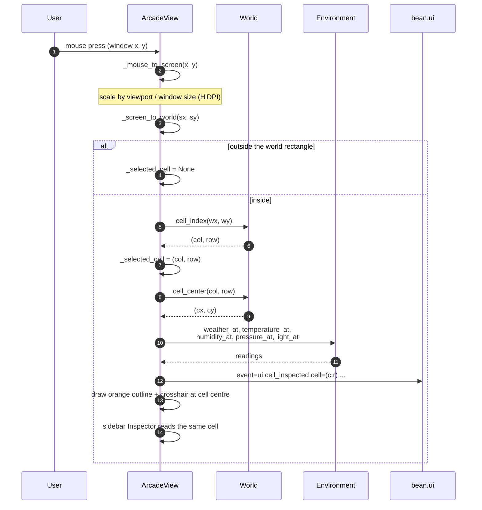
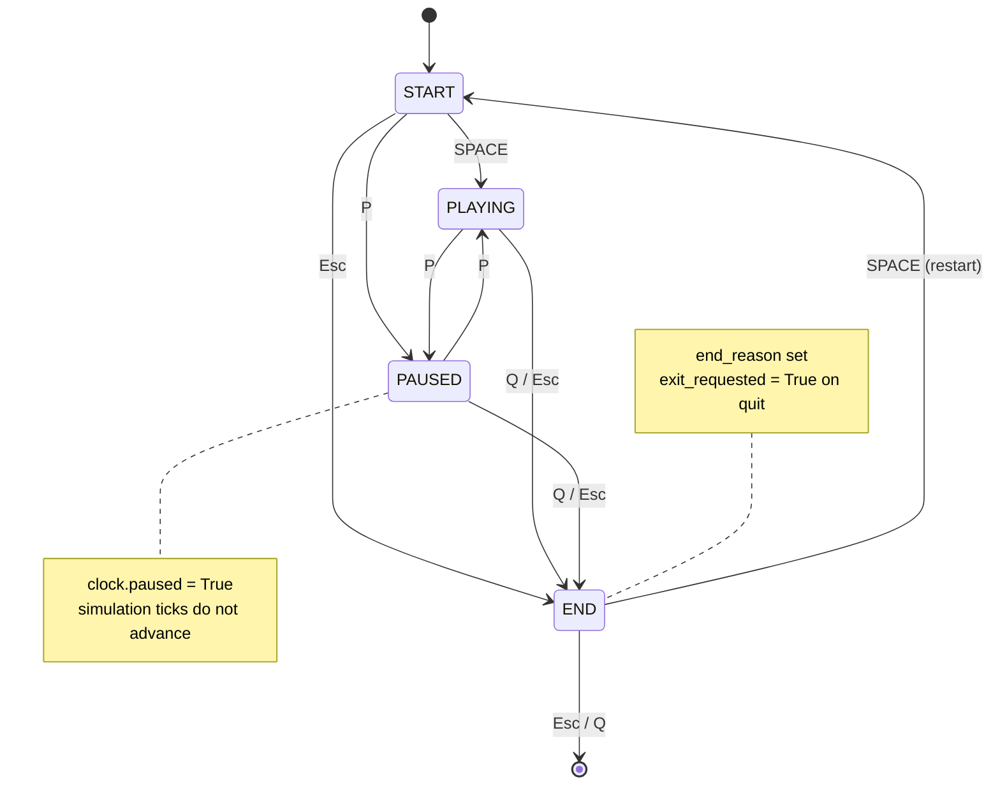
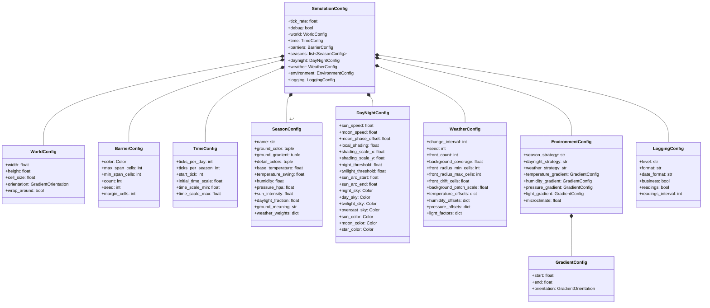
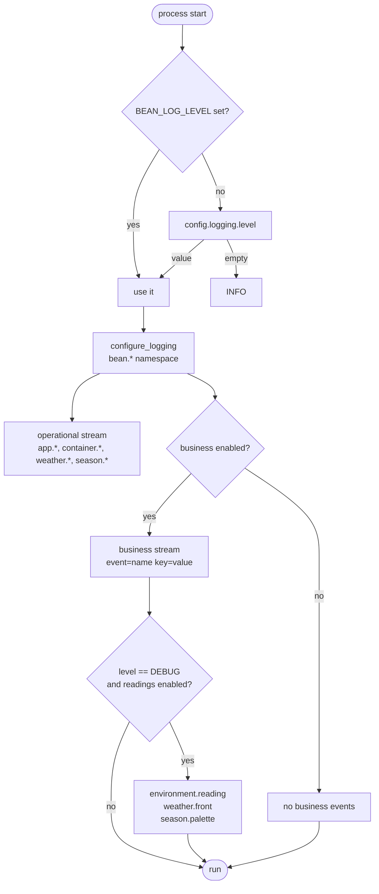

# Bean World — Diagrams

Mermaid diagrams of the current implementation. They are intentionally
code-accurate: names match `sim/` and the arrows follow real imports and calls.

- [Class diagram](#class-diagram)
- [Wiring sequence](#wiring-sequence)
- [Simulation tick sequence](#simulation-tick-sequence)
- [Reading composition](#reading-composition)
- [Render / input loop](#render--input-loop)
- [Click-to-inspect sequence](#click-to-inspect-sequence)
- [Session state machine](#session-state-machine)
- [Configuration composition](#configuration-composition)
- [Logging flow](#logging-flow)

---

## Class diagram

Domain, interfaces and implementations. `Environment` is the only object that
composes the three strategies into positional readings.

```mermaid
classDiagram
    direction LR

    class GameState {
        <<enumeration>>
        START
        PLAYING
        PAUSED
        END
    }

    class GameClock {
        +tick: int
        +paused: bool
        +accumulator: float
        +time_scale: float
        +set_time_scale(value)
    }

    class GameSession {
        +state: GameState
        +clock: GameClock
        +world: IWorld
        +environment: IEnvironment
        +end_reason: str
        +exit_requested: bool
    }

    class Calendar {
        +tick: int
        +day: int
        +day_fraction: float
        +clock: str
        +season: str
        +season_index: int
        +season_progress: float
        +day_of_season: int
        +year: int
        +advance(ticks)
        +reset()
    }

    class World {
        +width: float
        +height: float
        +cell_size: float
        +cols: int
        +rows: int
        +orientation: GradientOrientation
        +wrap_around: bool
        +barrier_strategy: IBarrierStrategy
        +cell_index(x, y) tuple
        +cell_center(col, row) tuple
        +add_barrier(barrier)
    }

    class Barrier {
        +id: int
        +kind: str
        +x: float
        +y: float
        +width: float
        +height: float
        +radius: float
        +color: tuple
    }

    class Environment {
        +calendar: ICalendar
        +season: str
        +phase: str
        +weather: str
        +light_level: float
        +palette: SeasonPalette
        +solar: SolarProfile
        +celestial: CelestialState
        +weather_at(x, y) str
        +light_at(x, y) float
        +humidity_at(x, y) float
        +pressure_at(x, y) float
        +temperature_at(x, y) float
        +advance_tick()
        +reset()
        -_temperature_gradient: Gradient
        -_humidity_gradient: Gradient
        -_pressure_gradient: Gradient
        -_light_gradient: Gradient
    }

    class Gradient {
        +orientation: GradientOrientation
        +start: float
        +end: float
        +factor(x, y, w, h) float
        +value(x, y, w, h) float
        +signed(x, y, w, h) float
    }

    class SolarProfile {
        +sun_intensity: float
        +daylight_fraction: float
    }

    class ClimateContext {
        +tick: int
        +season: str
        +solar: SolarProfile
        +base_temperature: float
        +humidity: float
        +pressure_hpa: float
        +weather_weights: dict
        +cols: int
        +rows: int
        +cell_size: float
        +adjusted_weather_weights() dict
        +climate_context() ClimateContext
    }

    class SeasonStrategy {
        +ticks_per_season: int
        +season_names: tuple
        +palette(calendar) SeasonPalette
        +solar_profile(calendar) SolarProfile
        +get_season_name(calendar) str
        +weather_weights(season) dict
    }

    class DayNightStrategy {
        +ticks_per_day: int
        +light_at(calendar, x, y, solar) float
        +phase(calendar, solar) str
        +celestial(calendar, solar) CelestialState
        +sky_palette() SkyPalette
    }

    class WeatherStrategy {
        +weather: str
        +weather_at(x, y) str
        +weather_at_cell(col, row) str
        +update(tick, climate)
        +reset()
        -_build(tick, climate)
        -_background_covers(col, row) bool
    }

    class BarrierStrategy {
        +color: tuple
        +max_span_cells: int
        +span_cells(barrier, world) tuple
        +validate(barrier, world)
        +create_barriers(world) list[Barrier]
    }

    class ArcadeView {
        +session: GameSession
        +set_input_handler(handler)
        +on_draw()
        +on_resize(w, h)
        +on_mouse_motion(x, y, dx, dy)
        +on_mouse_press(x, y, button, modifiers)
        +on_mouse_release(x, y, button, modifiers)
        -_layout: WorldLayout
        -_screen_to_world(sx, sy)
        -_world_to_screen(wx, wy)
        -_selected_cell: tuple
        -_hover_cell: tuple
        -_slider_rect: tuple
        -_text: _TextCache
    }

    class WorldLayout {
        +left: float
        +bottom: float
        +scale: float
        +cell_size: float
        +cols: int
        +rows: int
        +screen_to_world(sx, sy)
        +world_to_screen(wx, wy)
        +cell_index(x, y) tuple
        +cell_center(col, row) tuple
        +cell_screen_rect(col, row) tuple
    }

    class KeyboardInput {
        +handle_keypress(key)
        +set_time_scale(value)
    }

    class Container {
        +config: SimulationConfig
        +barrier_strategy: BarrierStrategy
        +world: World
        +calendar: Calendar
        +environment: Environment
        +session: GameSession
    }

    class ICalendar {
        <<interface>>
    }
    class ISeasonStrategy {
        <<interface>>
    }
    class IDayNightStrategy {
        <<interface>>
    }
    class IWeatherStrategy {
        <<interface>>
    }
    class IBarrierStrategy {
        <<interface>>
    }
    class IEnvironment {
        <<interface>>
    }
    class IWorld {
        <<interface>>
    }

    GameSession *-- GameClock
    GameSession --> IWorld
    GameSession --> IEnvironment

    Calendar ..|> ICalendar
    World ..|> IWorld

    SeasonStrategy ..|> ISeasonStrategy
    DayNightStrategy ..|> IDayNightStrategy
    WeatherStrategy ..|> IWeatherStrategy
    BarrierStrategy ..|> IBarrierStrategy
    Environment ..|> IEnvironment

    Environment --> ICalendar
    Environment --> ISeasonStrategy
    Environment --> IDayNightStrategy
    Environment --> IWeatherStrategy
    Environment --> IWorld
    Environment *-- Gradient

    WeatherStrategy --> IWorld

    BarrierStrategy --> IWorld
    Container --> BarrierStrategy
    Container --> World
    Container --> Calendar
    Container --> Environment
    Container --> GameSession

    ArcadeView --> GameSession
    KeyboardInput --> GameSession
    ArcadeView --> WorldLayout
```

---

## Wiring sequence

`main()` → `Container` → `GameSession`. Build order matters: the world provides
the cell grid used by weather, and the calendar needs the configured season
names.

---

## Simulation tick sequence

Fixed-step, pause-aware. `advance_clock` is the only place wall-clock time is
turned into ticks, and the environment advances once per tick.

---

## Reading composition

Each positional reading is a baseline from the season palette, plus weather
offsets, plus a positional gradient, plus a small microclimate term.

`GradientConfig.orientation` empty means "inherit `WorldConfig.orientation`".
Supported orientations: `north_south`, `south_north`, `west_east`, `east_west`,
`centre_out`, `out_centre`, `diagonal_up`, `diagonal_down`.

---

## Render / input loop

The view is read-only with respect to domain state. It samples the session and
never calls `advance_tick`.

---

## Click-to-inspect sequence

Selection is stored as an integer `(col, row)`. The orange marker and the
readings both derive from it, so they cannot disagree.

---

## Session state machine

`KeyboardInput` is the only writer of `GameSession.state`.

---

## Configuration composition

One module, no YAML. `DEFAULT_CONFIG` is the single object `main()` reads.

---

## Logging flow

Level resolution and the two log streams.

---

Back to [`README.md`](./README.md) · Original brief: [`spec.md`](./spec.md)
